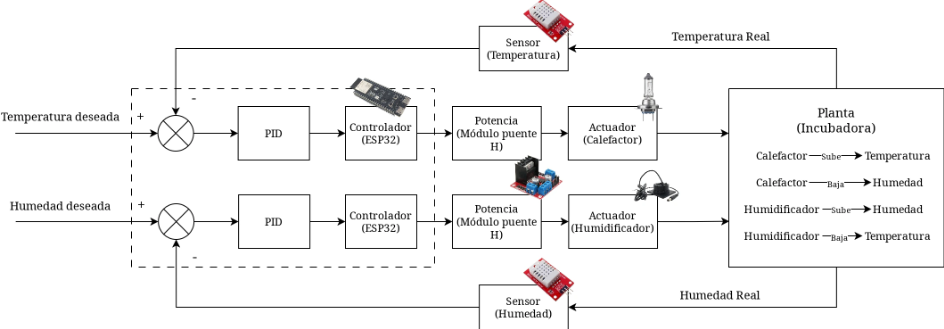

# Título del Proyecto: Sistema Adaptativo de Incubación para el Control Digital de Temperatura y Humedad Relativa (SADI)

## Objetivo General

Diseñar e implementar un sistema de control digital en lazo cerrado para regular la temperatura y la humedad relativa dentro de una incubadora, utilizando un microcontrolador ESP32 como controlador central, con el fin de mantener condiciones ambientales estables y rechazar perturbaciones externas.

## Arquitectura de Control (Estrategia)

El proyecto se fundamenta en un esquema de control multivariable (MIMO 2×2) que combina dos lazos de realimentación acoplados:

- **Cálculo Dinámico de Referencia (Feedforward):** Un sensor de temperatura ambiente exterior y un sensor de apertura de puerta permiten al algoritmo anticipar el efecto de perturbaciones externas sobre la cámara. Esta lectura es procesada matemáticamente para ajustar preventivamente las consignas o las señales de control antes de que el error se manifieste.
- **Regulación en Lazo Cerrado (Feedback):** Dos sensores internos retroalimentan la temperatura y la humedad relativa reales dentro de la cámara. Dos controladores digitales implementados en el ESP32 (un PID discreto para temperatura y un PI discreto para humedad) calculan el error entre la condición real y el *setpoint*, ajustando el ciclo de trabajo de las señales PWM enviadas a las etapas de potencia.
- **Desacoplo (Mejora opcional):** Una red de desacoplo entre las salidas de los controladores y los actuadores compensa el acoplamiento cruzado: el calefactor afecta la humedad relativa y el humidificador puede afectar la temperatura. Esto permite que cada lazo actúe sin perturbar significativamente al otro.

## Hardware y Elementos de la Planta

- **Unidad de Procesamiento:** Microcontrolador ESP32 operando como el controlador digital central, ejecutando ambos lazos de control en tiempo discreto.
- **Sensores:**
  - Sensor de temperatura y humedad interno (SHT31 o DHT22) ubicado en un punto representativo de la cámara, lejos del calefactor y del humidificador.
  - Sensor de temperatura ambiente exterior (DS18B20 o similar) para alimentar el lazo feedforward.
  - Sensor de apertura de puerta (reed switch o interruptor) para detección de perturbaciones bruscas.
- **Actuadores:**
  - Resistencia calefactora controlada por MOSFET de nivel lógico o SSR, con modulación por ancho de pulso (PWM) o time-proportioning.
  - Humidificador ultrasónico controlado por relé o MOSFET.
  - Ventilador de homogeneización controlado por PWM para distribuir el aire sin enfriar en exceso.
- **Planta:** Cámara térmicamente aislada con inercia térmica significativa, dinámica lenta, retardo de transporte y comportamiento no lineal por saturación de los actuadores.

## Justificación Técnica (El valor del Control Digital)

A diferencia de los enfoques convencionales de lazo abierto que simplemente aplican una tabla de valores fijos (temperatura vs. porcentaje de PWM), este diseño rechaza activamente las perturbaciones internas y externas de la planta. El controlador compensa variables como la caída de tensión en la fuente de alimentación, la pérdida de calor por apertura de puerta y el retardo térmico del sistema, asegurando que la temperatura y la humedad reales alcancen y mantengan la referencia calculada de forma rápida, estable y segura. La naturaleza multivariable del sistema exige además gestionar el acoplamiento entre ambos lazos, lo que añade un nivel de complejidad y rigor propio de un proyecto de control digital avanzado.

## Descripción general del prototipo SADI.

El proyecto *SADI (Sistema Adaptativo de Incubación para el Control Digital de Temperatura y Humedad Relativa)* se concibe como una solución integral que reemplaza la conmutación manual por un lazo cerrado de control digital. Su objetivo fundamental es regular de manera autónoma el microclima de una cámara de incubación, rechazando perturbaciones externas (tales como la pérdida repentina de calor por la apertura de compuertas) y estabilizando la planta térmica. El sistema fue diseñado con una meta de precisión estacionaria de ±1°C para la variable de temperatura y de ±10% para la humedad relativa.

Físicamente, el prototipo es una planta multivariable que integra:

- **Elementos de actuación:** Un foco halógeno resistivo como fuente térmica principal y un módulo ultrasónico sumergible para la inyección de humedad. Ambos elementos están apoyados por un ventilador axial de corriente continua encargado de generar convección forzada para homogeneizar el volumen de aire.
- **Sistema de instrumentación:** La retroalimentación de la planta se obtiene en tiempo real mediante un sensor digital DHT22, el cual monitorea las condiciones térmicas e higrométricas del ambiente interno.

## Arquitectura de control digital.

Para cumplir con los requerimientos dinámicos del sistema, la lógica de control recae sobre un microcontrolador ESP32-S3. Este dispositivo actúa como la unidad de procesamiento central, encargado de ejecutar los algoritmos PID discretizados a un periodo de muestreo ($T_s$) constante @astrom_pid.

La arquitectura electrónica incluye una etapa de potencia basada en un módulo puente H de dos salidas. Esta configuración permite al controlador aislar las corrientes de demanda operativa y enviar señales de control moduladas por ancho de pulso (PWM). De esta manera, el algoritmo PID calcula el esfuerzo de control en tiempo real (basándose en la magnitud, la acumulación y la tasa de cambio del error) y la etapa de potencia traduce ese valor matemático en una modulación proporcional de la energía eléctrica entregada al foco calefactor y al humidificador ultrasónico.

## Componentes utilizados dentro de la construcción del sistema cleanTECH:

- ### Puente-H BTS7960 IBT_2:

El **BTS 7960** es un módulo de potencia diseñado para el control de motores de corriente continua (DC) que requieren mucha energía. Integra en un solo encapsulado un interruptor de alta potencia superior (MOSFET de canal P), un interruptor inferior (MOSFET de canal N) y su propio circuito de control (driver). Es ideal para construir puentes H o sistemas de control de motores en robótica y automoción.

## Características principales
- **Alta corriente:** Soporta picos de hasta **43 A** y una corriente continua de 40 A.
- **Baja resistencia:** Tiene una resistencia de paso muy baja (típicamente 16 mΩ), lo que significa que pierde muy poca energía en forma de calor.
- **Control directo:** Se conecta fácilmente a microcontroladores (Arduino, ESP32, PIC, etc.) gracias a sus entradas de nivel lógico.
- **PWM Integrado:** Permite controlar la velocidad del motor mediante modulación por ancho de pulso (PWM) de hasta **25 kHz**.
- **Diagnóstico de corriente:** Incluye un pin de salida (IS) que informa al microcontrolador sobre la cantidad de corriente que está pasando por el motor y detecta fallos.
- **Protecciones integradas:** Evita daños por sobretemperatura, sobretensión, subtensión, sobrecorriente y cortocircuitos.
- **Reducción de ruido:** Al usar un MOSFET de canal P, no necesita una "bomba de carga" externa, lo que reduce las interferencias electromagnéticas (EMI). Además, permite ajustar la velocidad de conmutación (slew rate) con una resistencia externa.

## Distribución de Pines (Encapsulado de 7 u 8 pines)
El chip se conecta a la placa de la siguiente manera:
- **VS:** Alimentación de potencia (generalmente de 8V a 18V, con un máximo de 27.5V).
- **OUT:** Salida de potencia hacia el motor.
- **IN:** Entrada de control (decide si se activa el interruptor superior o el inferior).
- **INH:** Inhibidor (si se pone en bajo, el chip entra en modo de reposo y apaga ambas salidas).
- **SR:** Ajuste de la velocidad de conmutación (se conecta a tierra mediante una resistencia).
- **IS:** Salida de corriente y diagnóstico de errores (se conecta a una resistencia para medir el voltaje).
- **GND:** Tierra.

## ¿Cómo funciona internamente?
El BTS 7960 está diseñado para trabajar en configuraciones de medio puente. Para controlar un motor en ambos sentidos (adelante y atrás), normalmente se usan **dos** de estos chips juntos para formar un **Puente H**. 
El chip genera un "tiempo muerto" automático para asegurarse de que el interruptor superior y el inferior nunca se enciendan al mismo tiempo (lo cual causaría un cortocircuito). Si detecta un fallo, como una sobrecorriente, reduce la energía mediante un modo de conmutación rápida en lugar de calentarse peligrosamente.

## Aplicaciones comunes
- Control de motores de corriente continua en robótica.
- Sistemas de dirección y tracción en vehículos (automoción).
- Control de motores en impresoras 3D o máquinas CNC.
- Construcción de puentes H para inversión de giro.